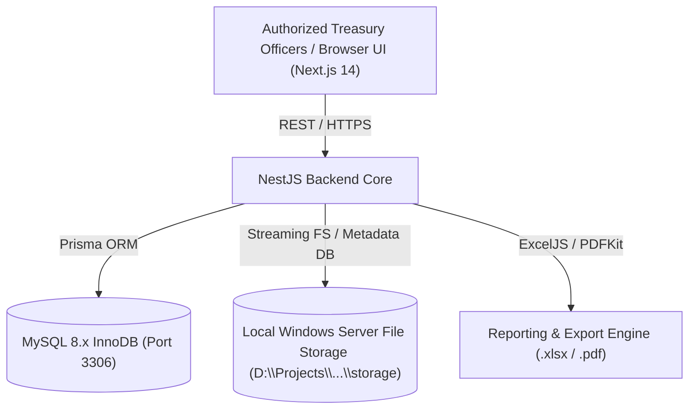

# Architecture Specification: HYDRAA Budget, Treasury & Expenditure Management System

## 1. System Context & Architecture
The system is built as a modular monolithic architecture adhering strictly to local Windows Server hosting guidelines for the Hyderabad Disaster Response and Asset Protection Agency (HYDRAA), Government of Telangana.

## 2. Core Accounting & Financial Invariants
1. **Double/Source Partitioning**: HMDA and PD funding sources maintain completely independent ledgers.
2. **Payment-Based Expenditure Posting**: Recording a bill generates an encumbrance/commitment, but official budget reduction only posts when payment settlement is executed.
3. **Transaction Immutability**: All budget additions, releases, additional releases, and settlements generate append-only transactional ledger entries with audit logs. Corrections require explicit reversal entries.
4. **Tax Segregation**: Gross Bill = Net Payable + Statutory Deductions (GST TDS, IT TDS, Other). Remittance does not double-count expenditure.
5. **Auditing**: Every create, update, delete, verification, download, and login attempt is logged with IP, user, timestamp, prior and new values.

